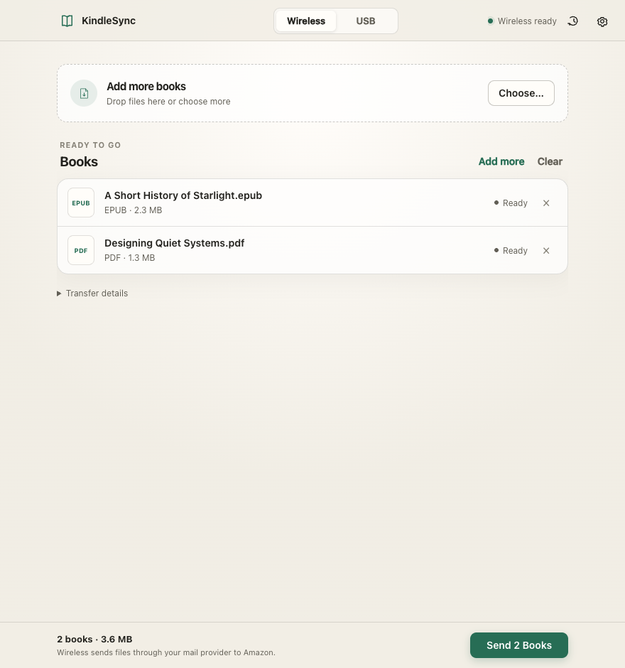
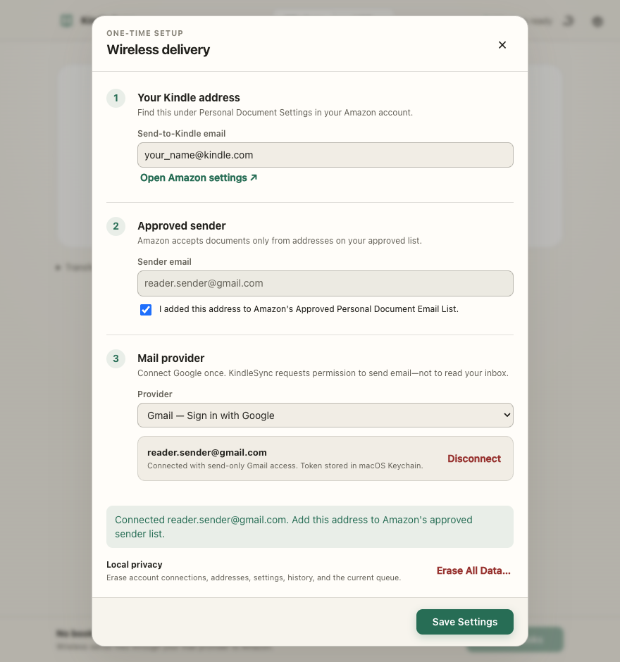

<p align="center">
  
</p>

<h1 align="center">KindleSync</h1>

<p align="center">
  Drop a book. Send it to your Kindle. No hosted account, background daemon, or permanent local server.
</p>

<p align="center">
  <a href="https://github.com/bharat94/kindle-sync/actions/workflows/ci.yml"></a>
  <a href="https://github.com/bharat94/kindle-sync/actions/workflows/security.yml"></a>
  <a href="LICENSE"></a>
  
</p>

<p align="center">
  <a href="#quick-start">Quick start</a> ·
  <a href="#delivery-options">Delivery options</a> ·
  <a href="#security-and-privacy">Security</a> ·
  <a href="PLAN.md">Roadmap</a>
</p>



KindleSync is a focused macOS Electron app for moving personal documents to Kindle. Add EPUBs, PDFs, and other supported files, choose Wireless or a connected legacy Kindle, and get a receipt that says exactly what the app can prove.

> [!IMPORTANT]
> KindleSync is currently source-first. CI produces verified development artifacts, but they are ad-hoc signed—not Developer ID signed or notarized—and are not yet public releases. See [Distribution status](#distribution-status).

## Why KindleSync

| Drop and send | Gmail without SMTP setup | Honest confirmation |
|---|---|---|
| Drag files into one native Mac window or open them from Finder. | Sign in with Google using send-only Gmail access. No SMTP hostname, port, or app password. | Wireless reports **Submitted** when the provider accepts mail; USB reports **Copied and verified** after a byte-count check. |

- Runs as a normal `.app`; no web hosting or localhost server remains running.
- Keeps settings, account identifiers, tokens, app passwords, and receipt history in one Keychain-backed encrypted envelope.
- Supports light/dark mode, keyboard navigation, file associations, Dock/Finder open-file flows, and macOS notifications.
- Separates legacy USB mass-storage Kindles from newer MTP models instead of pretending they work the same way.

## Quick start

Requirements: macOS 12 or newer, [Node.js 24](https://nodejs.org/), and npm.

```bash
git clone https://github.com/bharat94/kindle-sync.git
cd kindle-sync
npm ci
npm start
```

Then:

1. Drop an EPUB or PDF into the window.
2. Click **Send**. Setup opens only when needed.
3. Enter the `@kindle.com` address from Amazon's Personal Document Settings.
4. Add your sender to Amazon's Approved Personal Document Email List and confirm it in KindleSync.
5. Sign in with Google, save, and submit the queue.

[Open Amazon's Personal Document Settings](https://www.amazon.com/hz/mycd/myx#/home/settings/payment)

## Gmail setup that feels like a consumer app

<p align="center">
  
</p>

Gmail is the default path. KindleSync uses Google's installed-app OAuth flow with PKCE and requests only `gmail.send`, so it cannot read, search, modify, or delete inbox messages. The temporary callback listens on `127.0.0.1` only while sign-in is in progress and then closes.

iCloud Mail, Outlook, and custom SMTP are still available under **Use another mail provider** for users who need them.

### Enable Google sign-in in a development build

Google requires the app developer—not every user—to register a Desktop OAuth client. Create a Google Cloud project, enable Gmail API, configure the OAuth consent screen, and create a **Desktop app** client ID. No client secret is used or shipped.

```bash
KINDLESYNC_GOOGLE_CLIENT_ID="your-id.apps.googleusercontent.com" npm start
```

For a packaged build, set `kindleSync.googleOAuthClientId` in `package.json` before building. Packaged builds deliberately ignore environment-based client IDs and test overrides. Public use of the sensitive `gmail.send` scope requires Google's OAuth app verification.

## Delivery options

| Route | Status | Supported input | What the receipt proves |
|---|---|---|---|
| Gmail API | Ready with an OAuth client ID | Amazon-supported email formats | Gmail accepted the message |
| iCloud, Outlook, custom SMTP | Ready | Amazon-supported email formats | The outgoing server accepted the message |
| Legacy USB mass storage | Ready | PDF, TXT, AZW/AZW3, MOBI, KFX; EPUB through Calibre | Final file exists with the expected byte count |
| Modern Kindle over MTP | Detection and guided handoff | Use Wireless or Amazon's USB Manager | Device detected; no upload claim |

Wireless accepts EPUB, PDF, DOC/DOCX, TXT, RTF, HTML, JPEG, GIF, PNG, BMP, and ZIP containers. KindleSync batches Amazon's 25-document-per-email maximum and uses conservative provider-size limits.

Older Kindles that mount as writable volumes can receive compatible files directly. EPUB is converted to AZW3 when [Calibre](https://calibre-ebook.com/download_osx) is installed; a raw EPUB is never copied and reported as success.

Scribes and Kindle models released in 2024 or later use MTP on macOS and do not appear as normal `/Volumes` filesystems. KindleSync detects that state and links to [Amazon's official USB Manager instructions](https://digprjsurvey.amazon.com/csad/help/node/TCUBEdEkbIhK07ysFu). Native MTP transfer remains tracked in [PLAN.md](PLAN.md).

### What “Submitted” means

Amazon does not expose a documented public API for tracking Personal Document conversion or arrival. A wireless receipt therefore says **Submitted**, never **Delivered**. It proves that Gmail or the configured mail server accepted the message. Check the Kindle device/app and the sender inbox for Amazon verification or error mail.

## Security and privacy

The renderer is sandboxed, context-isolated, and has no Node.js access. It sees opaque file IDs and safe metadata—not source paths or credentials. A narrow preload bridge validates IPC calls, while the main process owns files, delivery services, settings, and external navigation.

Private app-managed data is written as a single encrypted payload using Electron `safeStorage`, backed by macOS Keychain:

- Kindle and sender addresses
- Google account identity and refresh token
- SMTP configuration and app password
- selected USB preference and receipt history

The on-disk config exposes only a schema version and ciphertext. Writes are atomic and owner-readable, and **Erase All Data** clears config, queue, browser state, and local tokens. SMTP secrets are invalidated if their provider, host, port, TLS mode, or username changes.

KindleSync has no analytics or hosted backend. Wireless delivery necessarily shares the selected document with the mail provider and Amazon; USB mass storage stays local. Selected ebooks and active Calibre conversion output necessarily exist in plaintext while in use, and conversion residue is cleaned after use and on the next launch after a crash.

See [SECURITY.md](SECURITY.md) for the full data-handling promise and private vulnerability reporting.

## Build, test, and verify

```bash
npm run check       # parse every application and test JavaScript file
npm run test:all    # 29 unit/integration + 6 Playwright Electron E2E tests
npm run build       # ad-hoc-signed universal DMG and ZIP
npm run verify:package
```

The package verifier checks more than “electron-builder exited successfully”:

- valid nested code seals and a universal `arm64` + `x86_64` executable
- valid DMG checksum and testable ZIP archive
- an explicit ASAR allowlist with no tests, docs, local config, or environment files
- hardened Electron fuses: Run-as-Node, `NODE_OPTIONS`, CLI inspection, and extra file privileges disabled; cookie encryption and embedded ASAR integrity enabled
- a launch of the packaged renderer over the local `kindlesync://` protocol
- sandbox boundaries and rejection of hostile production environment overrides
- ciphertext-only persistence on CI's disposable macOS account

CI runs source checks and real Electron E2E tests on macOS, then independently builds and verifies the universal app. A separate security workflow performs signature-aware dependency auditing and CodeQL analysis. Successful main-branch builds upload short-lived DMG/ZIP artifacts, SHA-256 checksums, and GitHub build-provenance attestations.

Tests intentionally do not claim to prove external systems. Live Google delivery needs a registered OAuth client/test user and approved sender; live SMTP needs provider credentials; physical USB coverage needs actual Kindle hardware. Those release gates remain explicit in [PLAN.md](PLAN.md).

## Distribution status

Electron already provides the Mac wrapper—no Automator app or persistent local web server is needed.

```bash
npm run build:dir      # universal unpacked app in dist/mac-universal/
npm run build          # local development DMG + ZIP, ad-hoc signed
npm run build:release  # Developer ID build; fails closed without signing
```

CI artifacts are useful for reproducibility and testing, but ad-hoc signing is not a publisher identity and Gatekeeper does not treat it as a trusted public release. Public distribution still requires the repository owner to supply an Apple Developer ID certificate, notarize the app, staple the notarization ticket, and test the DMG on a clean Mac. The public Google OAuth client must also pass Google's verification.

## Troubleshooting

<details>
<summary><strong>Submitted, but the book did not appear</strong></summary>

Confirm the sender is approved, the Kindle address is correct, and Amazon's verification or error email is not waiting in the sender inbox. KindleSync cannot observe Amazon's post-submission processing.
</details>

<details>
<summary><strong>Sign in with Google is unavailable or fails</strong></summary>

Development builds need `KINDLESYNC_GOOGLE_CLIENT_ID`. Confirm Gmail API is enabled, the account is an allowed test user while the consent screen is in Testing, and the OAuth client type is **Desktop app**.
</details>

<details>
<summary><strong>A document is too large</strong></summary>

Mail providers can impose lower limits than Amazon. Use Amazon's official [Send to Kindle web uploader](https://www.amazon.com/sendtokindle) for documents up to its published web limit.
</details>

<details>
<summary><strong>No USB Kindle appears</strong></summary>

Use a data-capable cable, unlock the Kindle, close other transfer apps, and reconnect. A modern MTP Kindle will show a guided handoff instead of a writable-volume destination.
</details>

<details>
<summary><strong>macOS asks to access confidential Keychain information</strong></summary>

KindleSync uses macOS Keychain to protect the encryption key for saved settings. The prompt is expected when the app first needs protected storage. Denying it leaves the data unsaved and does not expose anything; allow access only for a build you trust.
</details>

## Architecture

```text
Renderer (sandboxed UI)
    │ narrow, validated IPC
Preload bridge
    │
Main process ── file registry ── local source files
    ├────────── Google OAuth / Gmail API
    ├────────── SMTP providers
    ├────────── legacy Kindle volume + Calibre
    └────────── encrypted config + macOS Keychain
```

The implementation is deliberately service-oriented without adding a framework layer: `src/main/` contains the config, authentication, mail, device, conversion, and copy boundaries; `renderer/` contains the static interface; `test/` covers unit, integration, and Electron journeys.

## Contributing

Issues and pull requests are welcome. Start with [CONTRIBUTING.md](CONTRIBUTING.md), read [SECURITY.md](SECURITY.md) before handling credentials or filesystem boundaries, and keep user-facing delivery language aligned with what can actually be proven.

## References

<details>
<summary>Authoritative product and implementation references</summary>

- [Amazon: Send methods, encryption, and formats](https://digprjsurvey.amazon.com/csad/help/node/G5WYD9SAF7PGXRNA)
- [Amazon: Email limits and rules](https://digprjsurvey.amazon.com/csad/help/node/G7NECT4B4ZWHQ8WV)
- [Amazon: Approved sender setup](https://digprjsurvey.amazon.com/csad/help/node/GX9XLEVV8G4DB28H)
- [Amazon: Personal-document compatibility](https://digprjsurvey.amazon.com/csad/help/node/TNtSm13k3txFI4EvDV)
- [Electron security checklist](https://www.electronjs.org/docs/latest/tutorial/security)
- [Electron `safeStorage`](https://www.electronjs.org/docs/latest/api/safe-storage)
- [Google OAuth for desktop apps](https://developers.google.com/identity/protocols/oauth2/native-app)
- [Gmail API `users.messages.send`](https://developers.google.com/gmail/api/reference/rest/v1/users.messages/send)
- [Playwright Electron automation](https://playwright.dev/docs/api/class-electron)
</details>

## License

[MIT](LICENSE) © KindleSync contributors
